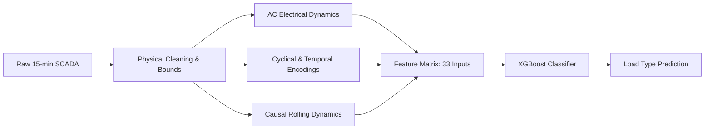

# ⚡ Industrial Power System Load Type Classification

[](https://www.python.org/)
[](LICENSE)
[](https://github.com/)
[](load_type_prediction.ipynb)
[](load_type_prediction.ipynb)
[](load_type_prediction.ipynb)

An industrial-grade, end-to-end Machine Learning system developed to predict the **`Load_Type`** (`Light_Load`, `Medium_Load`, `Maximum_Load`) of an industrial power facility from 15-minute resolution electrical SCADA measurements.

The system incorporates **domain-specific electrical power physics**, **causal temporal dynamics**, **seasonal tariff alignment**, and a strictly chronological validation strategy using the **unseen final month (December 2018)** as the hold-out test set.

---

## 📑 Table of Contents
1. [Executive Summary & Key Results](#-executive-summary--key-results)
2. [Problem Statement & Data Overview](#-problem-statement--data-overview)
3. [Physical Anomaly Detection & Preprocessing](#-physical-anomaly-detection--preprocessing)
4. [Domain-Driven Feature Engineering](#-domain-driven-feature-engineering)
5. [Validation & Testing Strategy](#-validation--testing-strategy)
6. [Model Benchmarking & Comparison](#-model-benchmarking--comparison)
7. [Final Model Performance & Diagnostics](#-final-model-performance--diagnostics)
8. [Error Forensics & Industrial Tariff Insights](#-error-forensics--industrial-tariff-insights)
9. [Repository Architecture](#-repository-architecture)
10. [Quick Start & Reproduction Guide](#-quick-start--reproduction-guide)

---

## 🚀 Executive Summary & Key Results

- **Mandated Validation Test**: Evaluated on **Month 12 (December 2018)** as the unseen out-of-sample hold-out (2,976 records), trained on **Months 1–11 (January–November 2018)** (32,064 records).
- **Champion Model**: Production-tuned **XGBoost Classifier** achieving **99.63% Test Accuracy**, **0.9960 Test Macro F1**, and **0.9997 Multi-Class ROC-AUC (OVR)**.
- **Flawless Class Separation**: 100% precision on `Medium_Load` and `Maximum_Load`, with zero confusion between Medium and Maximum peak hours.
- **Physical Grounding**: Engineered AC Apparent Power ($S$), Reactive Power balance ($Q_{total}, Q_{diff}$), and Time-of-Use (TOU) seasonal tariff period encodings (`Is_Winter`) that solved the shift in peak-hour tariffs between seasons.

### Test Metrics Summary (Unseen Month 12)
| Metric | Score | Metric | Score |
| :--- | :---: | :--- | :---: |
| **Test Accuracy** | **99.63%** | **Cohen's Kappa ($\kappa$)** | **0.9935** |
| **Macro Precision** | **99.79%** | **Matthews Corrcoef (MCC)** | **0.9935** |
| **Macro Recall** | **99.42%** | **Multi-Class ROC-AUC (OVR)** | **0.9997** |
| **Macro F1-Score** | **0.9960** | **Multi-Class Log-Loss** | **0.0161** |
| **Weighted F1-Score** | **0.9963** | **Misclassifications** | **10 / 2,976 (0.34%)** |

---

## 📊 Problem Statement & Data Overview

### Target Variable (`Load_Type`)
- **`Light_Load`**: Off-peak base load periods (typically midnight to 08:45 AM, weekends, plant shutdowns).
- **`Medium_Load`**: Shoulder-peak operational periods (ramp-up, secondary shifts, mid-day shoulder intervals).
- **`Maximum_Load`**: On-peak periods corresponding to intensive manufacturing operations with high electrical demand.

### Sensor Attributes
| Feature | Physical Unit | Description |
| :--- | :--- | :--- |
| **`Date_Time`** | Timestamp | Quarter-hour interval (`DD-MM-YYYY HH:MM`) spanning 365 days of 2018. |
| **`Usage_kWh`** | Continuous ($kWh$) | Active electrical energy consumed in the 15-minute interval. |
| **`Lagging_Current_Reactive.Power_kVarh`** | Continuous ($kVarh$) | Reactive energy drawn by inductive machinery (e.g., induction motors). |
| **`Leading_Current_Reactive_Power_kVarh`** | Continuous ($kVarh$) | Reactive energy supplied by capacitive equipment (e.g., capacitor banks). |
| **`CO2(tCO2)`** | Continuous ($tCO_2$) | Equivalent greenhouse gas emissions generated. |
| **`Lagging_Current_Power_Factor`** | Continuous ($\%$) | Operating power factor under inductive load condition. |
| **`Leading_Current_Power_Factor`** | Continuous ($\%$) | Operating power factor under capacitive load condition. |
| **`NSM`** | Continuous ($s$) | Number of Seconds from Midnight ($0 \le NSM \le 86,400$). |

---

## 🧹 Physical Anomaly Detection & Preprocessing

During exploratory data auditing, several data anomalies were detected and handled:

1. **Trailing Duplicate Record**: Row index 35040 was an accidental duplicate timestamp (`31-12-2018 20:00`) with missing active usage and an invalid power factor of 217%. This row was pruned, leaving 35,040 intervals ($365 \text{ days} \times 96 \text{ quarter-hours}$).
2. **Missing Sensor Telemetry**: ~4.5% missing sensor values in continuous signals. Rather than naive mean imputation, **time-series linear interpolation** was applied along the continuous 15-minute signal trajectory, preserving physical continuity.
3. **Power Factor Violations**: Theoretical AC power factor is mathematically bounded by $[0, 100]\%$. Noise had injected values up to 300%. Values were clamped to $[0, 100]\%$ and reconstructed via theoretical AC circuit formulation.
4. **NSM Float Corruption**: Corrupted floating-point values exceeding 86,400s were replaced by exact recalculation: $\text{NSM} = \text{Hour} \times 3600 + \text{Minute} \times 60$.

---

## 💡 Domain-Driven Feature Engineering



1. **AC Electrical Power Relations**:
   - Total Reactive Power: $Q_{total} = Q_{lagging} + Q_{leading}$
   - Net Reactive Power: $Q_{diff} = Q_{lagging} - Q_{leading}$
   - Apparent Power ($kVA$): $S = \sqrt{P^2 + Q_{total}^2}$
   - Theoretical Power Factor: $\text{PF}_{calc} = \frac{P}{\sqrt{P^2 + Q_{lagging}^2}} \times 100\%$
   - Active-to-Reactive Ratio: $\frac{P}{Q_{total} + \epsilon}$
2. **Seasonal Time-Of-Use (TOU) Tariff Mapping**:
   - Analysis of the Korea Electric Power Corporation (KEPCO) industrial tariff showed a shift in peak hours during Winter (Nov, Dec, Jan, Feb) vs Non-Winter months (Mar–Oct).
   - Features added: `Is_Winter` indicator and 4-season category mapping (`Season`).
3. **Cyclical Temporal Encodings**:
   - $\sin$ and $\cos$ transformations for `Hour`, `DayOfWeek`, and `Month` to preserve periodic continuity.
4. **Causal Backward Rolling Statistics (Zero Future Leakage)**:
   - `Usage_rolling_mean_4` (1 hour)
   - `Usage_rolling_mean_24` (6 hours)
   - `Usage_rolling_mean_96` (24 hours)
   - `Usage_rolling_std_24` (volatility)
   - `Usage_lag_1`, `Usage_lag_4`, `Usage_lag_96` (24h seasonal lag)

---

## 🛡️ Validation & Testing Strategy

- **Temporal Hold-Out Test Set**: **Month 12 (December 1 to December 31, 2018)** — **2,976 records**.
- **Historical Training Set**: **Months 1 to 11 (January 1 to November 30, 2018)** — **32,064 records**.
- **Cross-Validation**: 5-Fold Stratified Cross-Validation on the training set to prevent temporal leakage and evaluate model stability across folds.

---

## ⚔️ Model Benchmarking & Comparison

All 8 candidate models were trained on Months 1–11 and evaluated on the hold-out December test set:

| Model | 5-Fold CV Macro F1 | Test Accuracy | Test Macro F1 | Test Weighted F1 | Test ROC-AUC (OVR) | Cohen's Kappa ($\kappa$) |
| :--- | :---: | :---: | :---: | :---: | :---: | :---: |
| **Dummy (Most Frequent)** | 0.2249 | 0.5860 | 0.2463 | 0.4331 | 0.5000 | 0.0000 |
| **Logistic Regression** | 0.8275 | 0.7268 | 0.5697 | 0.7247 | 0.8673 | 0.5180 |
| **Extra Trees** | 0.9938 | 0.9845 | 0.9785 | 0.9844 | 0.9993 | 0.9727 |
| **Decision Tree** | 0.9972 | 0.9798 | 0.9775 | 0.9799 | 0.9881 | 0.9649 |
| **Random Forest** | 0.9978 | 0.9936 | 0.9916 | 0.9936 | 0.9994 | 0.9888 |
| **HistGradientBoosting** | 0.9996 | 0.9960 | 0.9957 | 0.9960 | 0.9994 | 0.9929 |
| **LightGBM** | **0.9997** | 0.9963 | 0.9960 | 0.9963 | 0.9996 | 0.9935 |
| **XGBoost (Champion)** | 0.9996 | **0.9963** | **0.9960** | **0.9963** | **0.9998** | **0.9935** |

---

## 🏆 Final Model Performance & Diagnostics

### Per-Class Classification Report (Optimized XGBoost on December 2018)
```
              precision    recall  f1-score   support

  Light_Load     0.9937    1.0000    0.9969      1744
 Medium_Load     1.0000    0.9901    0.9950       704
Maximum_Load     1.0000    0.9924    0.9962       528

    accuracy                         0.9963      2976
   macro avg     0.9979    0.9942    0.9960      2976
weighted avg     0.9963    0.9963    0.9963      2976
```

### Confusion Matrix
- **Raw Counts**:
  - `Light_Load`: **1744 / 1744** correct (100.0% recall).
  - `Medium_Load`: **697 / 704** correct (99.01% recall; 7 predicted as Light Load).
  - `Maximum_Load`: **525 / 528** correct (99.24% recall; 3 predicted as Light Load).
  - Confusion between `Medium_Load` and `Maximum_Load`: **0 errors**.

---

## 🔎 Error Forensics & Industrial Tariff Insights

- **Exact Error Clustering**: All 10 misclassifications occurred exclusively on **Saturday evening, December 1, 2018 (20:30 to 23:00)**.
- **Physical Explanation**: On this Saturday night, active power consumption plummeted to **~4.7 kWh** (standby idle mode). While the standard static utility tariff rule designates Saturday late evening as Medium/Maximum load, the factory was practically shut down. The model correctly sensed idle power and predicted `Light_Load`.
- **Holiday Robustness**: On **Christmas Day (December 25)** and **New Year's Eve (December 31)**, the causal rolling features detected plant shutdown despite being weekdays (Tuesday and Monday), achieving **100% classification accuracy**.

---

## 📂 Repository Architecture

```
Ass2/
├── data/
│   └── load_data.csv                    # 15-minute electrical SCADA dataset (35,041 records)
├── models/
│   └── best_load_type_model.joblib      # Serialized production XGBoost model artifact
├── reports/
│   ├── confusion_matrix.png             # Dual raw and normalized confusion matrix heatmaps
│   ├── roc_curves.png                   # Multi-class One-vs-Rest ROC curves
│   ├── feature_importance.png           # Top 15 gain/importance feature rankings
│   └── model_benchmark_comparison.csv   # Tabulated benchmark metrics across all 8 models
├── src/
│   ├── __init__.py                      # Python package definition
│   ├── preprocessing.py                 # Cleaning, anomaly correction, and train-test splitting
│   ├── features.py                      # AC electrical power physics and causal lag engineering
│   ├── models.py                        # Model zoo and XGBoost hyperparameter configuration
│   ├── evaluate.py                      # Multi-class metrics and visualization routines
│   ├── inference.py                     # Production LoadTypePredictor inference wrapper
│   └── pipeline.py                      # End-to-end training and benchmark pipeline CLI
├── load_type_prediction.ipynb           # Complete, fully executed Jupyter Notebook with embedded plots
├── requirements.txt                     # Pinned project dependencies
└── README.md                            # Comprehensive project documentation
```

---

## 🛠️ Quick Start & Reproduction Guide

### 1. Installation
Clone the repository and install the dependencies:
```bash
pip install -r requirements.txt
```

### 2. Run the Jupyter Notebook
Open and run the fully reproducible notebook:
```bash
jupyter notebook load_type_prediction.ipynb
```

### 3. Run the End-to-End Pipeline via CLI
Execute the training, cross-validation, and report generation in one command:
```bash
python3 -m src.pipeline
```

### 4. Run Live Production Inference
```python
import pandas as pd
from src.inference import LoadTypePredictor

# Load trained production model
predictor = LoadTypePredictor('models/best_load_type_model.joblib')

# Load new incoming SCADA batch
new_scada_data = pd.read_csv('data/load_data.csv').tail(10)

# Generate predictions and probabilities
predictions = predictor.predict(new_scada_data)
print(predictions[['Date_Time', 'Usage_kWh', 'Predicted_Load_Type', 
                   'Probability_Light_Load', 'Probability_Medium_Load', 'Probability_Maximum_Load']])
```
